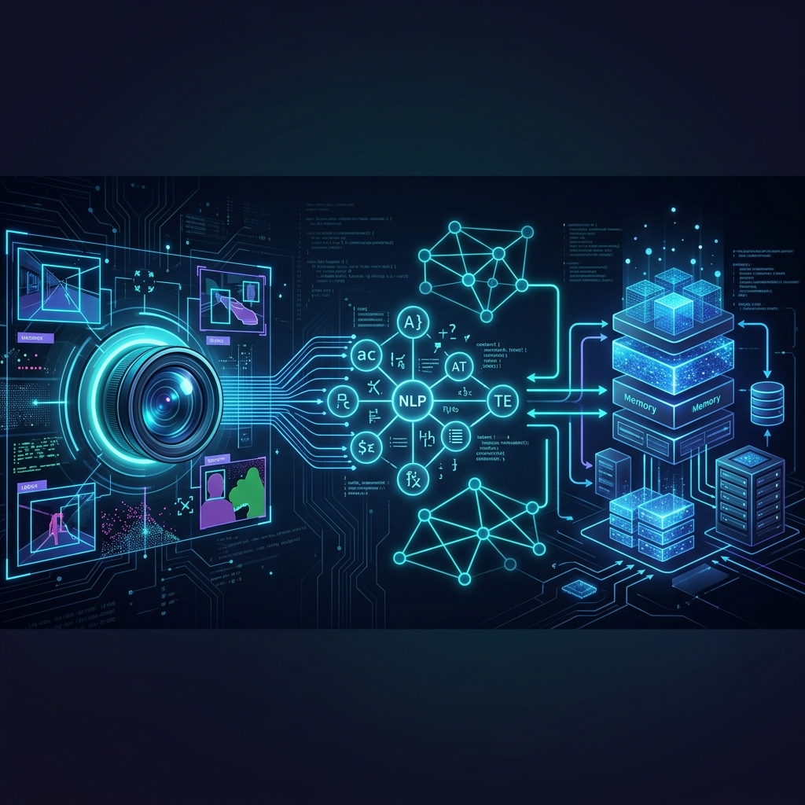

# 👷‍♂️ AI Visual Compliance System (CV-NLP RAG)


<div align="center">
  
</div>

## 📖 Executive Summary

The **AI Visual Compliance System** is an advanced, multi-modal pipeline designed to automate workplace safety monitoring. By integrating **Computer Vision (CV)** with **Retrieval-Augmented Generation (RAG)** and Large Language Models (LLMs), the system not only detects safety violations in real-time but also cross-references them against company-specific safety policies to generate structured, evidence-based compliance reports.

## ✨ Key Features

*   **Real-Time Violation Detection:** Utilizes a custom-trained YOLOv8 model to accurately detect Personal Protective Equipment (PPE) compliance (e.g., helmets).
*   **Dynamic Policy Retrieval:** Implements a RAG pipeline (LangChain, FAISS) to search and retrieve exact regulatory text from internal company documents (PDFs, TXTs).
*   **AI Safety Officer:** Leverages Google Gemini 1.5 Flash to synthesize visual data and retrieved policies, outputting logical and explainable compliance verdicts.
*   **Interactive Dashboard:** A user-friendly Streamlit interface for uploading footage, managing policy documents, and visualizing real-time analysis.

## 🏗️ System Architecture

The architecture is decoupled into three highly cohesive engines:

1.  **The "Eyes" (CV Engine):** Processes video frames/images to extract structured metadata about detected objects and their spatial coordinates.
2.  **The "Memory" (RAG Engine):** Converts domain-specific safety manuals into vector embeddings (HuggingFace) and performs semantic search to fetch relevant context.
3.  **The "Brain" (NLP/LLM Engine):** Acts as the reasoning layer, taking the structured visual output and the retrieved policy context to generate a comprehensive human-readable report.

## 🛠️ Technology Stack

| Component | Technology |
| :--- | :--- |
| **Computer Vision** | YOLOv8 (Ultralytics), OpenCV |
| **Generative AI** | Google Gemini (1.5 Flash API) |
| **RAG Pipeline** | LangChain, HuggingFace (`all-MiniLM-L6-v2`) |
| **Vector Database** | FAISS (In-memory) |
| **Backend & UI** | Python, Streamlit |

## 🚀 Installation & Setup

### Prerequisites
*   Python 3.9 or higher
*   Git

### 1. Clone the Repository
```bash
git clone https://github.com/bilalahmed251/cv-nlp-rag-project.git
cd cv-nlp-rag-project
```

### 2. Install Dependencies
```bash
pip install -r requirements.txt
```

### 3. Environment Variables
To enable the LLM features, you must provide a Google Gemini API Key.
Create a `.env` file in the root directory:
```env
GEMINI_API_KEY=your_api_key_here
```
*(Alternatively, you can input the key directly via the Streamlit UI).*

### 4. Run the Application
```bash
streamlit run app.py
```
Navigate to `http://localhost:8501` in your browser to access the system.

## 🎯 Model Training & Evaluation

The custom PPE detection model (`best.pt`) was trained using Ultralytics YOLOv8.

* **Training Notebook:** Available at [`training/Project_Training.ipynb`](training/Project_Training.ipynb) for full reproducibility.
* **Base Architecture:** YOLOv8 Nano (`yolov8n.pt`), 50 epochs, AdamW optimizer (`imgsz=640`).
* **Fast Training Turnaround:** Full retraining takes only ~8 minutes on a standard Google Colab T4 GPU.

### 📊 Performance & Calibration
* **Overall Metrics:** `mAP50: 0.85`, `Precision: 0.93`, `F1-Score: 0.82 at 0.444 confidence`.
* **Known Limitation:** `NoHelmet recall 0.58-0.73, small test set.` (At standard confidence, Precision is 0.96 while Recall is ~0.58 with mAP50 of 0.73).
* **Threshold Recommendation:** In production safety auditing, missing a violation (false negative) is costlier than a minor false alarm. Lowering the detection confidence threshold to `0.35 – 0.40` significantly improves `NoHelmet` recall.
* **Future Optimization:** While deployment and core pipeline stability are prioritized first, future retraining iterations can scale to `yolov8s` or 100 epochs with augmented hard negative mining to drive `NoHelmet` recall above 0.85+.

## 📜 Dataset Attribution (CC BY 4.0)

This project utilizes the **Hard Hat Detection** dataset (`hard-hat-detection-4iltu`) hosted on [Roboflow Universe](https://universe.roboflow.com/melnikdm/hard-hat-detection-4iltu/dataset/10), originally created and shared by **melnikdm** under the **Creative Commons Attribution 4.0 International (CC BY 4.0)** license.

## 🗺️ Roadmap (Upcoming Features)

- [ ] Transition from FAISS to **ChromaDB** for persistent vector storage.
- [ ] Migrate frontend to a robust **Next.js / React Dashboard**.
- [ ] Implement robust **Automated Testing** (Pytest, Jest).
- [ ] Containerize the application using **Docker** for seamless deployment.

---
*Developed by **Bilal Ahmed***
